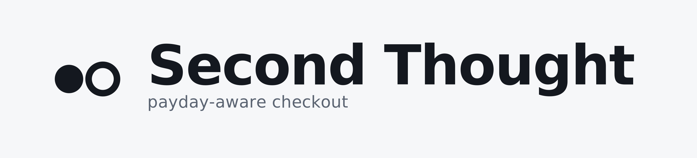
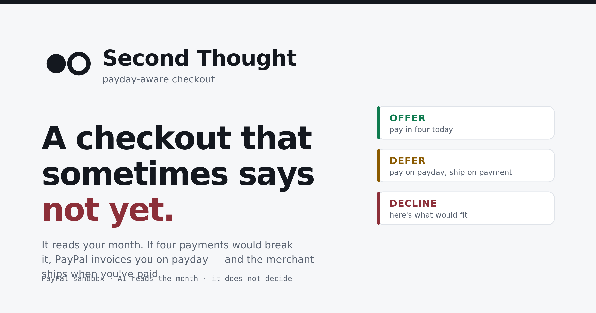
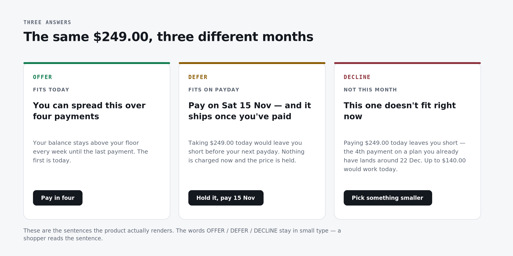
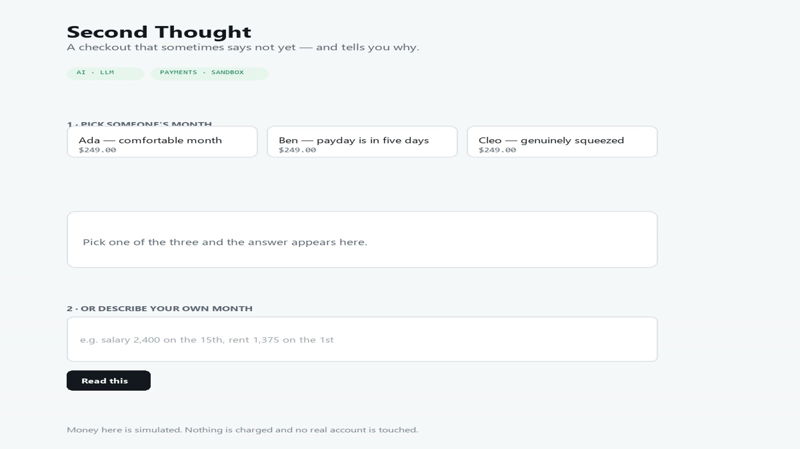
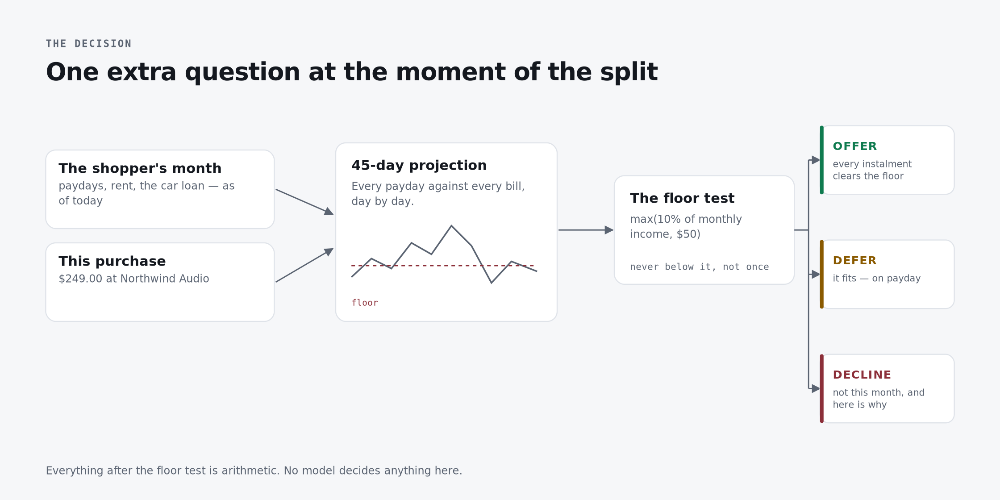
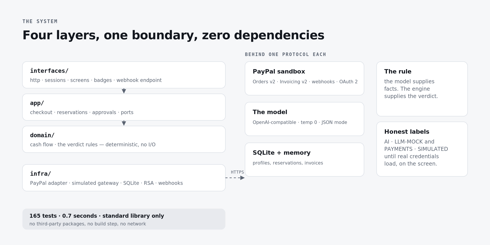
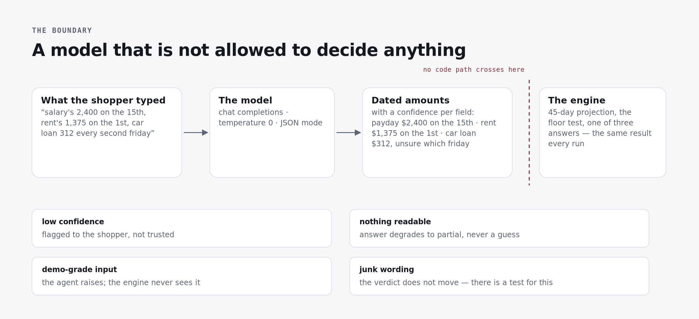
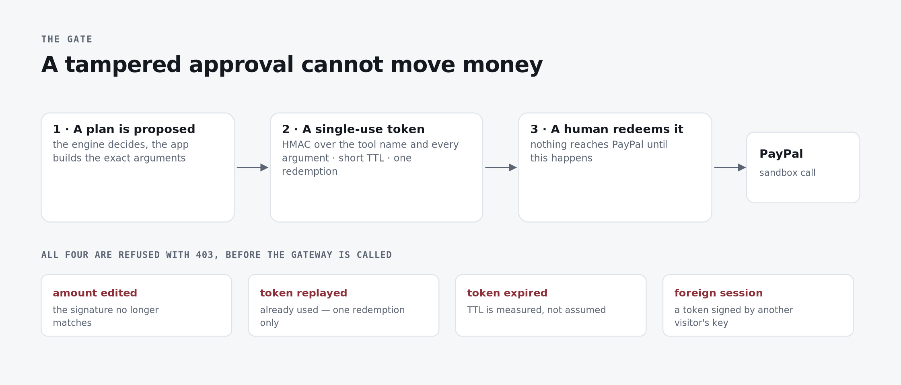

<p align="center">
  
</p>

<h1 align="center">A checkout that sometimes says <em>not yet</em>.</h1>

<p align="center">
  <strong>Second Thought projects the shopper's next 45 days before Pay Later is offered.</strong><br>
  It can offer today, hold the purchase for payday, or decline with a safer amount and a reason.
</p>

<p align="center">
  <a href="https://second-thought-h61b.onrender.com"><strong>Live demo</strong></a> ·
  <a href="https://second-thought-h61b.onrender.com/proof"><strong>Live proof</strong></a> ·
  <a href="assets/demo/second-thought-demo.mp4"><strong>60-second demo video</strong></a> ·
  <a href="product/README.md"><strong>Technical README</strong></a>
</p>

<p align="center">
  
  
  
  
  
</p>

<p align="center">
  
</p>

## The idea in one minute

Most BNPL systems ask **how much** the purchase costs and **where** the shopper lives. Second Thought
asks a more useful question:

> **Will this purchase fit this person's month?**

It projects income and existing commitments across the next 45 days, then returns a plain-language,
explainable outcome. The same $249 purchase can produce three different answers:

| Shopper | What the system sees | Outcome | What happens next |
|---|---|---|---|
| Ada | A comfortable month | **OFFER** | PayPal `AUTHORIZE` reserves funds for a short window |
| Ben | A car payment lands before payday | **DEFER** | A dated invoice is created; the shop ships only after payment |
| Cleo | The month is already squeezed | **DECLINE** | The collision is named and a safer amount is suggested |

<p align="center">
  
</p>

The memorable answer is not “declined.” It is:

> **This one doesn't fit right now.**<br>
> Paying $249.00 today leaves you short because a payment already in your month lands first.<br>
> **Up to $140.00 would work today.**

## See it working

### Live product

Open the [public demo](https://second-thought-h61b.onrender.com) and click Ada, Ben, and Cleo. No
login or setup is required. The [proof page](https://second-thought-h61b.onrender.com/proof) exposes
measured checks, engine constants, lifecycle rules, and the gates that are still open.

The demo runs in honest simulated-payment mode by default. The page badges make that visible; no real
account or production payment is touched. The Render deployment uses the free plan and may sleep after
inactivity, so its first request after idle can take longer.

### Demo video

[](assets/demo/second-thought-demo.mp4)

The submission package includes an original narrated soundtrack, music, UI sound design, poster frame,
and upload notes in [`assets/demo/`](assets/demo/). The cut is 60 seconds, 1920×1080, and comfortably
under the three-minute judging limit. Upload it to YouTube as Public or Unlisted when submitting.

## Why this matters

Second Thought is designed for the merchant who would rather keep a sale that can happen in three weeks
than lose it today — without pretending that the merchant has become a bank.

- **The shopper gets timing, not pressure.** A refusal explains what collides and what smaller amount
  would fit.
- **The merchant keeps control.** A deferred order is pay-before-ship; `fulfil()` cannot run until
  payment is recorded.
- **PayPal remains the rail.** This replaces the lender-shaped decision, not PayPal payments. The
  intended opportunity is a sale that would otherwise leave for Klarna or disappear.
- **The limits are explicit.** This prototype does not claim to solve collections, calibration, or
  human validation. An unpaid reservation can expire or be released; a shopper uses the merchant's
  support path if the date no longer works.

### The economics are visible

For a $400 order, the comparison is explicit rather than hand-waved:

| | PayPal Pay in 4 | Second Thought plan book |
|---|---:|---:|
| Merchant fee | $20.45 | $0 |
| Expected loss assumption | Borne by PayPal | $10.80 at a 2.7% reference rate |
| Merchant keeps | $379.55 today | About $389.20 after payment arrives |

The trade is real: the merchant waits, and carries the plan-book risk. The product earns credibility by
showing that trade instead of hiding it.

## How it works

<p align="center">
  
</p>

```text
shopper's month + purchase
          |
          v
45-day cash-flow projection
          |
          v
safety-floor test
   /       |        \
OFFER    DEFER     DECLINE
 today   payday     safer amount
```

The architecture keeps language and money in separate lanes:

<p align="center">
  
</p>

| Layer | Responsibility |
|---|---|
| `domain/` | Pure cash-flow math, policy, verdicts, safe amounts, and the reservation state machine |
| `app/` | Quote → propose → approve → execute orchestration |
| `ai/` | Reads messy shopper text into dated facts; never decides money |
| `infra/` | PayPal adapter, simulated gateway, SQLite, RSA verification, webhooks |
| `interfaces/` | HTTP API, session isolation, honest badges, browser experience, and `/proof` |

## AI that cannot decide money

The model reads text such as:

> “Salary is 2,400 on the 15th, rent is 1,375 on the 1st, and my car loan is 312 every second Friday.”

It returns structured dates, amounts, confidence, and questions when it is unsure. The deterministic
engine then decides the financial outcome. There is no code path from model output to a money verdict.

<p align="center">
  
</p>

The UI says `AI · LLM-MOCK` until a real model is intentionally configured. Offline mode is a first-class
fallback, not a hidden fake.

## PayPal integration depth

The live adapter is sandbox-only and uses server-side OAuth. It covers:

- OAuth 2 client credentials: `POST /v1/oauth2/token`
- Orders v2: create, `AUTHORIZE`, capture, and void
- Invoicing v2: create/send with `payment_term.due_date`
- PayPal webhooks with RSA-SHA256 signature verification over the raw body
- `PayPal-Request-Id` idempotency for mutating calls

The browser demo uses the simulated gateway by default. The CLI instruments the same contracts with
`--dry-run` and `--live`, so the code path remains inspectable without ever allowing PayPal production.
See [`product/README.md`](product/README.md) for endpoint details and the known Sandbox Invoicing
permission limitation.

<p align="center">
  
</p>

## Safety and trust boundaries

The project treats money movement as a security boundary:

- HMAC approvals are bound to the exact tool and arguments, expire, and cannot be replayed.
- Sessions are isolated; one visitor cannot spend another visitor's budget.
- Webhook signatures are verified before events reach payment state.
- Unknown money tools, altered amounts, and missing approvals fail closed.
- A verified but unlinked or conflicting payment remains retryable rather than being silently accepted.
- `PAYPAL_ENV=live` is refused by the adapter.

Read the implementation-linked threat model in [`product/SECURITY.md`](product/SECURITY.md).

## Run it locally

Requirements: Python 3.11 or newer. Runtime dependencies: none.

```bash
cd product

# Start the browser experience
python scripts/serve.py

# Run the complete product and safety suite
python -m unittest discover -s tests -q
python scripts/preflight_deploy.py

# Exercise the product in the terminal
python -m secondthought.cli
python demo.py --dry-run
python demo_ai.py --offline
```

Then open [http://localhost:8000](http://localhost:8000). For live Sandbox checks, configure local
credentials in `product/.env` and use `python demo.py --live`; never commit that file or production
credentials.

## Evidence and assets

The repository includes a complete visual language, not just a logo:

| Asset | Use |
|---|---|
| [`assets/index.html`](assets/index.html) | Browse the complete visual system |
| [`assets/png/devpost-thumbnail.png`](assets/png/devpost-thumbnail.png) | Submission thumbnail |
| [`assets/png/og-card.png`](assets/png/og-card.png) | GitHub/social preview |
| [`assets/png/diagram-verdicts.png`](assets/png/diagram-verdicts.png) | Three outcomes from one purchase |
| [`assets/png/diagram-defer.png`](assets/png/diagram-defer.png) | Payday deferral and pay-before-ship |
| [`assets/png/diagram-ai-boundary.png`](assets/png/diagram-ai-boundary.png) | Model/engine boundary |
| [`assets/png/diagram-architecture.png`](assets/png/diagram-architecture.png) | System architecture |
| [`assets/png/diagram-gate.png`](assets/png/diagram-gate.png) | Approval and tamper protection |
| [`assets/png/diagram-clusters.png`](assets/png/diagram-clusters.png) | Position against the field |
| [`assets/demo/`](assets/demo/) | Video, poster, and YouTube upload notes |

SVG sources, PNG exports, and generation notes live under [`assets/`](assets/). The assets are local,
consistent, and network-independent.

## Verification snapshot

Measured locally from the canonical `product/` application:

- **173 tests** passing
- **31** Windows HTTP/session security regression tests in the local fallback runner
- **17/17** deployment preflight checks
- **0** third-party runtime dependencies
- **MIT** licensed
- Public `/`, `/proof`, and `/healthz` routes on Render

The live deployment is intentionally honest: it currently runs with simulated payments and the mock AI
badge. Credentials for PayPal Sandbox and a model provider are kept out of the public service until the
corresponding live checks are complete.

## Repository map

```text
.
├── product/                 canonical application and tests
├── assets/                  logos, diagrams, submission media, and visual index
├── docs/research/           sourced research and market evidence
├── docs/plan/               delivery plan, gates, and submission copy
└── 09_build/prototype/      frozen earlier prototype; reference only
```

- [`product/README.md`](product/README.md) — deep technical documentation
- [`product/SECURITY.md`](product/SECURITY.md) — threat model and known limits
- [`docs/Second-Thought-Dossier.pdf`](docs/Second-Thought-Dossier.pdf) — full project dossier
- [`09_build/prototype/README.md`](09_build/prototype/README.md) — archived prototype context

## License

MIT — see [`LICENSE`](LICENSE).
