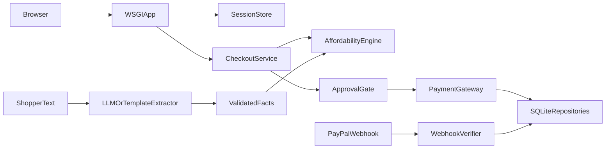

# Second Thought architecture

`product/` is the only active application in this repository. The code is a
stdlib-only Python 3.11+ service with a deliberately one-way dependency flow:

```text
interfaces -> app -> domain
     |         |
     v         v
  infra <--- ports
     ^
     |
    ai -> validated facts -> domain
```

## Runtime composition

The WSGI application is assembled in
[`product/secondthought/interfaces/http.py`](../../product/secondthought/interfaces/http.py).
It creates:

- an in-memory session store and per-session approval gate;
- SQLite repositories using `ST_DB_PATH`;
- the simulated gateway when PayPal credentials are absent;
- the sandbox PayPal adapter when credentials are configured;
- webhook verification and the self-contained browser screen.

`PAYPAL_ENV=live` remains rejected by the PayPal adapter. The HTTP process is
therefore sandbox-or-simulated only.

## Request flow



## Domain

[`product/secondthought/domain/`](../../product/secondthought/domain/) contains
the money rules and does not import the model or infrastructure:

- `cashflow.py` represents paydays, obligations, instalments, and projections;
- `engine.py` evaluates pay-now, pay-in-four, payday, and partial options;
- `reservation.py` enforces `RESERVED -> PAID -> FULFILLED`.

Money is integer minor units. The engine projects 45 days and returns `OFFER`,
`DEFER`, or `DECLINE`, including a collision and safe amount where applicable.

## Application and AI

`app/checkout.py` turns a decision into a quote, proposal, approved execution,
reservation, invoice, or authorization. `app/approvals.py` signs exact tool
arguments with expiring, single-use HMAC tokens.

`ai/extract.py` and `ai/template.py` only produce validated dated facts.
`ai/agent.py` passes those facts to the deterministic engine. An extraction with
no usable facts produces `NO_DECISION`; model wording cannot override the engine.

## Persistence and deployment

SQLite stores profiles, reservations, ledger entries, and webhook event state.
Sessions and approval tokens are intentionally process-local, so Render is
configured as a single instance. The configured SQLite path is honored, but
Render's `/tmp` filesystem is ephemeral; durable multi-instance operation would
require managed storage and external session state.

Use [`product/README.md`](../../product/README.md) for setup, tests, local
execution, configuration, and deployment commands.
